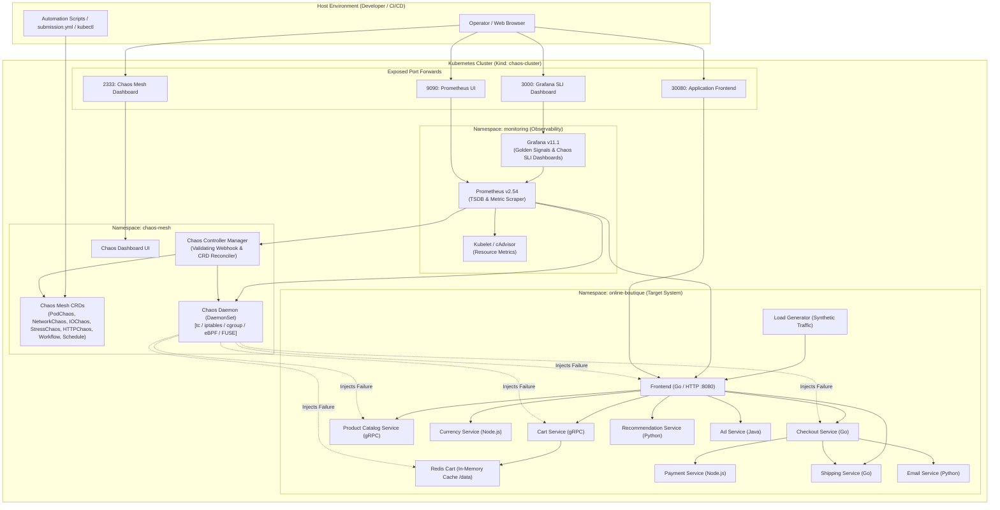
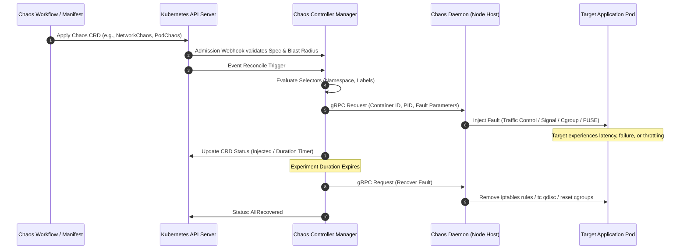
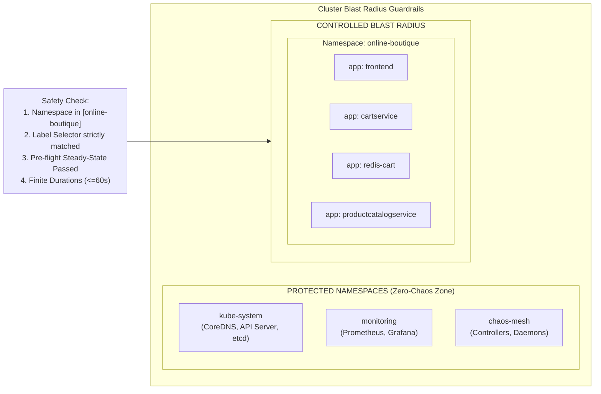
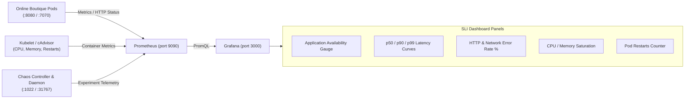
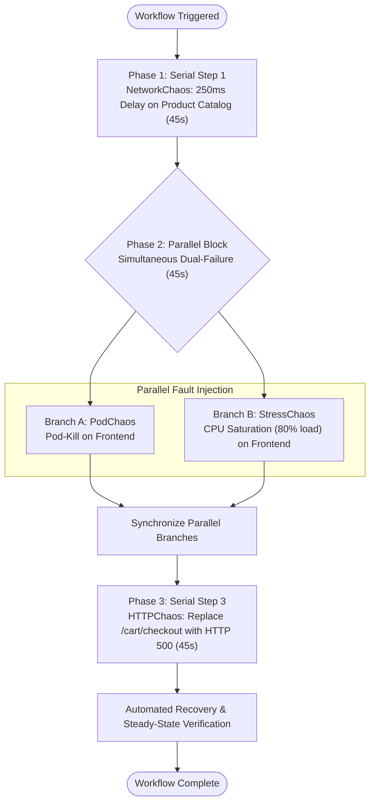

# Chaos Engineering Platform Architecture & System Design

## 1. Executive Summary

This document specifies the technical architecture, design patterns, fault injection mechanics, safety boundaries, and observability pipelines of the **Chaos Engineering Platform** deployed on Kubernetes using **Chaos Mesh**.

The platform is designed to shift reliability testing from reactive incident response to **proactive, automated, hypothesis-driven resilience discovery**. By systematically injecting pod disruptions, network degradation, storage latency, CPU/memory saturation, and API-level faults into a realistic microservices environment, the system exposes architectural weaknesses—such as cascading timeouts, missing circuit breakers, and unhandled dependency failures—before they impact end users.

---

## 2. Platform Architecture Overview

The platform comprises four discrete layers organized into isolated Kubernetes namespaces:

1. **Control Plane & Container Orchestration Layer (`kube-system`, `local-path-storage`)**: Provides the Kubernetes API, kubelet, CoreDNS, and CNI networking.
2. **Chaos Engineering Engine (`chaos-mesh`)**: Houses the Chaos Mesh Controller Manager, Chaos Daemons (DaemonSet with hostPID access for eBPF/tc/cgroup injection), and the Chaos Web Dashboard.
3. **Target Application Layer (`online-boutique`)**: A cloud-native 11-tier microservice architecture (Google Online Boutique) featuring gRPC and HTTP inter-service communication, in-memory caching (Redis), and an autonomous synthetic traffic generator.
4. **Observability & SLI Monitoring Stack (`monitoring`)**: Prometheus server scraping application endpoints, cAdvisor, and Chaos Mesh components, feeding a tailored Grafana Service-Level Indicator (SLI) dashboard.

### High-Level Architecture Diagram

---

## 3. Component Deep Dive & Interactions

### 3.1 Chaos Mesh Engine Architecture

Chaos Mesh operates as a cloud-native operator leveraging the Kubernetes Controller Pattern and Mutating/Validating Admission Webhooks:

1. **Chaos Controller Manager**:
   - Reconciles custom resources (`PodChaos`, `NetworkChaos`, `IOChaos`, `StressChaos`, `HTTPChaos`, `Workflow`, `Schedule`).
   - Translates high-level declarative intent into low-level runtime instructions.
   - Schedules and sequences complex multi-stage workflows.
2. **Chaos Daemon**:
   - Deployed as a `DaemonSet` with privileged permissions and host namespace access (`hostPID: true`, `hostNetwork: false`).
   - Communicates with the node container runtime socket (`/run/containerd/containerd.sock`).
   - Uses Linux kernel facilities to inject faults:
     - **NetworkChaos**: Manipulates kernel packet scheduling queues using `tc` (Traffic Control) and `netem` (Network Emulation), or manipulates routing via `iptables`.
     - **PodChaos**: Sends `SIGKILL`, `SIGTERM`, or attaches pause containers via container runtime APIs.
     - **StressChaos**: Invokes `stress-ng` in the target cgroup subsystem (memory and CPU controllers) to exhaust resource allocations.
     - **IOChaos**: Mounts dynamic FUSE (Filesystem in Userspace) file systems or attaches eBPF kprobes to inject latency and error codes into file descriptor operations (`read`, `write`, `sync`).
     - **HTTPChaos**: Proxies or patches HTTP packets via `tproxy` or sidecar interception to modify status codes, abort connections, or inject synthetic response delays.

---

## 4. Blast Radius Containment & Safety Controls

Chaos experiments have the potential to destabilize unexpected system components if unconstrained. To enforce strict **blast radius boundaries**, the platform incorporates multiple defensive layers:

### Safety Controls Implemented:

| Safety Mechanism | Implementation Details | Purpose |
| :--- | :--- | :--- |
| **Namespace Isolation** | Explicit `namespaces: [online-boutique]` defined in all experiment specs | Prohibits failure injection into `kube-system`, `monitoring`, or `default`. |
| **Granular Label Selectors** | Exact match on `labelSelectors: { app: <service-name> }` | Guarantees experiments isolate one microservice at a time (e.g. only `frontend` or only `redis-cart`). |
| **Strict Mode & Scope Limits** | `mode: one` or `fixed: 1` utilized for destructive tests | Prevents simultaneous complete cluster outages by ensuring at least one replica survives where applicable. |
| **Mandatory Durations** | Explicit `duration` parameter (30s to 60s) on all experiments | Prevents orphaned or permanent faults in the event of an orchestrator disconnect. |
| **Concurrency Safeguards** | `concurrencyPolicy: Forbid` in `Schedule` resources | Forbids overlapping scheduled tests, preventing compounding runaway failures. |
| **Pre-flight Health Checks** | Automated synthetic probes verifying HTTP 200 and latency baseline (< 500ms) before injection | Aborts chaos test initiation if the system is already degraded. |

---

## 5. Observability & Telemetry Architecture

To uphold the core chaos engineering principle of **measuring steady state**, the observability stack captures metrics from the application, infrastructure, and chaos engine simultaneously.

### Metrics Pipeline Flow

### Golden Signals & Service-Level Indicators (SLIs)

1. **Latency**:
   - Metric: `histogram_quantile(0.99, sum(rate(http_request_duration_seconds_bucket[1m])) by (le)) * 1000`
   - Steady-State Baseline: p50 < 25ms, p99 < 80ms.
2. **Traffic**:
   - Metric: `sum(rate(container_network_receive_packets_total{namespace="online-boutique"}[1m])) by (pod)`
   - Baseline: Continuous synthetic workload generated by `loadgenerator`.
3. **Errors**:
   - Metric: `(sum(rate(container_network_receive_errors_total{namespace="online-boutique"}[1m])) / sum(rate(container_network_receive_packets_total{namespace="online-boutique"}[1m]))) * 100`
   - Baseline: 0.0% error rate during steady state.
4. **Saturation**:
   - Metric: `sum(rate(container_cpu_usage_seconds_total{namespace="online-boutique"}[1m])) by (pod)` and `container_memory_working_set_bytes`
   - Baseline: Average CPU utilization < 25% across all microservices.

---

## 6. Multi-Stage Chaos Workflow Topology

The cascading failure workflow (`chaos/workflows/cascading-failure-workflow.yaml`) simulates a progressive real-world outage combining upstream network degradation, compute saturation, pod crashes, and API failures:

This sequence tests the application's ability to withstand compounding stress:
- Can the frontend gracefully render partial catalogs when the catalog is delayed?
- Does Kubernetes replica rescheduling maintain uptime when a saturated frontend pod is killed?
- Does the client interface handle payment/checkout failures gracefully without hanging or double-charging?

---

## 7. Network and Port Allocation

| Service | Cluster Type | Cluster Port | NodePort | Host Port | Purpose |
| :--- | :--- | :--- | :--- | :--- | :--- |
| `frontend-external` | NodePort | 80 / 8080 | 30080 | `30080` | Online Boutique E-Commerce Web Store |
| `chaos-dashboard` | NodePort | 2333 | 32333 | `2333` | Chaos Mesh Experiment Management UI |
| `prometheus` | NodePort | 9090 | 30090 | `9090` | Prometheus Metrics & PromQL Console |
| `grafana` | NodePort | 3000 | 30300 | `3000` | Grafana SLI & Resilience Dashboards |

All host ports are permanently bound via Kind's `extraPortMappings`, ensuring local access without requiring manual `kubectl port-forward` background processes.
